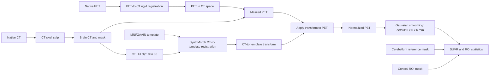

# SynCT

SynCT is a 3D Slicer scripted module for CT-guided PET spatial normalization and PET quantification. It aligns PET to the subject's CT, estimates a CT-to-template transform with SynthMorph, applies it to PET, smooths normalized PET, and computes reference-region SUVR and ROI statistics.

## Quick start

[Watch the English SynCT walkthrough (AVI video)](docs/SynCT_quick_start.avi). It is an **illustrated workflow**, not a recording of a patient analysis. See the [video storyboard](docs/VIDEO_GUIDE.md) for the exact sequence.

1. Clone this repository. In 3D Slicer, add the directory containing `SynCT.py` under `Edit > Application Settings > Modules > Additional module paths`. Restart Slicer and open `PET Quantification > SynCT`.
2. Install the dependencies below. Download the SynthMorph weights and place them in `mri_synthmorph/synthmorph/`.
3. Put paired `CT.nii` and `AV45_PET.nii` in a subject directory. Provide a template corresponding to your cerebellum and cortex masks. No patient images are distributed in this repository.
4. Expand `5. GAAIN AV45 SUVR`. Select the patient directory, template, masks, and output directory. Confirm the CT/PET filenames.
5. Use the default `joint` model and `6 x 6 x 6 mm` Gaussian smoothing. Configure the SynthMorph backend, click `Check GAAIN SynthMorph backend`, then `Run GAAIN AV45 SUVR`.
6. Inspect the normalized PET, smoothed PET, SUVR image, and `AV45_GAAIN_ctx_SUVR.csv` in the output directory. Check image and mask alignment in Slicer before interpreting the values. The CSV includes `CL = 175 * SUVR_Mean - 182`.

## Real 3D Slicer demonstrations

These two English-language, silent videos use **different subjects** and show CT-guided spatial normalization through 6 mm FWHM Gaussian smoothing. They do not demonstrate the AV45-specific SUVR or CL calculation. No source DICOM or processed patient image files are included in this repository.

| Video | Backend | What it shows |
| --- | --- | --- |
| [FDG PET/CT CPU demo](docs/FDG_CPU_Slicer_demo.avi) | CPU | A captioned, step-by-step sequence of screenshots from an actual 3D Slicer run. This is not a continuous screen recording. |
| [CIT PET/CT WSL GPU demo](docs/CIT_WSL_GPU_Slicer_demo.avi) | WSL GPU | A continuous recording of the actual Slicer window, including a visible cursor indicator. Processing is driven by Slicer automation rather than manual button clicks. |

To follow either video with your **own** PET/CT pair in `PET Quantification > SynCT`:

1. Use `1. DICOM import` to convert CT and PET to NIfTI, or load existing NIfTI volumes with `File > Add Data`. Confirm PET and CT belong to the same examination.
2. In `3. Registration`, set native CT as `Fixed/reference` and PET as `Moving/input`; click `Run rigid registration`.
3. In `2. Preprocess`, run CT skull stripping, clip the brain CT to HU `[0, 80]`, and apply the CT brain mask to the registered PET.
4. In `3. Registration`, set the clipped CT as `SynthMorph moving` and the MNI template as `SynthMorph fixed`. Select `joint`, choose `Slicer Python`/CPU or `WSL GPU` as appropriate, check the backend, and click `Run SynthMorph`. The GPU device shown in the CIT recording (`CUDA_VISIBLE_DEVICES=0`) is specific to that computer; check your own device mapping.
5. Still in `3. Registration`, apply the saved CT-to-template SynthMorph transform to the masked PET using B-spline interpolation.
6. In `4. PET quantification`, select the normalized PET and enable `Smooth PET before SUVR` with `6/6/6 mm` FWHM. Supply a reference mask to create an SUVR image, or inspect the spatially normalized and smoothed PET separately as shown in the videos. Verify PET/template alignment before quantitative interpretation.

The [illustrated quick-start video](docs/SynCT_quick_start.avi) remains available for an overview. AVI playback may require a local video player or download from GitHub.

## Processing workflow



## Installation

```bash
git clone https://github.com/yanyan-7/SynCT.git
```

In 3D Slicer, open `Edit > Application Settings > Modules`. Add the cloned repository directory to `Additional module paths`, restart Slicer, and open `PET Quantification > SynCT`.

SynCT calls Slicer's `BRAINSFit` and `BRAINSResample` CLI modules and the `SwissSkullStripper` CLI. If `swissskullstripper` is unavailable, install or enable the corresponding extension in Slicer's Extension Manager and restart Slicer.

For DICOM conversion, smoothing, file-based NIfTI processing, and XLSX output, install these packages in Slicer's Python console:

```python
slicer.util.pip_install("dicom2nifti pydicom nibabel scipy openpyxl")
```

SynthMorph additionally requires TensorFlow, surfa, voxelmorph, neurite, and related packages. On Windows, follow [mri_synthmorph/WSL_GPU_SETUP.md](mri_synthmorph/WSL_GPU_SETUP.md) for the WSL GPU backend. The `Slicer Python` backend requires compatible SynthMorph dependencies in Slicer's Python environment.

### SynthMorph weights

Download the weights from the [official SynthMorph site](https://synthmorph.io) and place them at these exact paths:

```text
mri_synthmorph/synthmorph/synthmorph.affine.2.h5
mri_synthmorph/synthmorph/synthmorph.deform.3.h5
```

The `joint` model requires both files. `affine` and `rigid` use the affine file; `deform` uses the deform file. Weights are not included in this repository. Missing weights cause a `model weights not found` error.

## Input data

Already-converted NIfTI images can be loaded in Slicer with `File > Add Data` for manual processing. The one-click GAAIN AV45 workflow expects:

```text
Subject001/
  CT.nii
  AV45_PET.nii
```

Supply a suitable template image. The repository includes masks offered as defaults in the GAAIN AV45 form:

```text
Atlas/Abeta_ctx_meta_roi_2mm/voi_CerebGry_2mm.nii
Atlas/Abeta_ctx_meta_roi_2mm/voi_ctx_2mm.nii
```

Confirm that your template and masks correspond spatially. ASCII-only data/output paths can avoid WSL path encoding problems.

## Module guide

### 1. DICOM import

Select `CT DICOM dir`, `PET DICOM dir`, and `Output dir`. Set output names, then click `Convert CT` or `Convert PET`. `Convert PET to SUV using DICOM dose metadata` requires complete dose, injection/acquisition time, half-life, and patient weight information. If these are unavailable, convert to SUV externally and import the resulting NIfTI image.

### 2. Preprocess

**CT skull strip:** Choose native CT as `Skull strip input`, set `Brain output` and `Mask output`, and click `Run skull strip`.

**CT clip:** Choose `CT clip input`, enter `Clip minimum` and `Clip maximum`, optionally normalize to 0-1 or save as NIfTI, then click `Clip CT`. The automatic AV45 workflow clips the brain CT to HU `[0, 80]`.

**Apply mask to PET:** Choose PET already aligned to CT as `PET volume`, choose the CT brain mask as `Mask volume`, then click `Apply mask to PET`. Mask resampling uses nearest-neighbor interpolation when needed.

### 3. Registration

**Rigid PET-to-CT:** Set `Fixed/reference` to native CT and `Moving/input` to native PET. Choose output names, intensity interpolation (`BSpline` or `Linear`), and sampling fraction (default `0.01`); click `Run rigid registration`.

**Apply Slicer transform:** Select `Apply input volume`, `Transform`, and `Reference volume`, then click `Apply transform`. Use `NearestNeighbor` for masks/labels.

**SynthMorph registration:** Set `SynthMorph moving` to clipped brain CT and `SynthMorph fixed` to the template. Set registered-image and transform output paths. Select `joint` by default, configure `WSL GPU` or `Slicer Python`, verify with `Check SynthMorph backend`, and click `Run SynthMorph`.

**Apply SynthMorph transform:** Select the saved transform, PET in native CT space, and an output path. Use `bspline` or `linear` for PET and `nearest` for labels; click `Apply SynthMorph transform`.

### 4. PET quantification

**Create SUVR image:** Select normalized PET/SUV as `PET/SUV input`. `Smooth PET before SUVR` is enabled by default. Set `Smoothing FWHM X/Y/Z` in millimetres (default `6/6/6`), name the smoothed output, and optionally save it as NIfTI. Select `Reference mask`, set the SUVR output, and click `Create SUVR image`. With smoothing enabled:

```text
SUVR = smoothed PET / mean(smoothed PET inside the reference mask)
```

**Compute ROI statistics:** Select the intensity image and ROI label volume. Leave `ROI labels` blank for all nonzero integer labels or enter values such as `1,2,5-8`. Optionally save CSV/XLSX; click `Compute ROI statistics` for voxel count, mean, standard deviation, minimum, and maximum.

**Compute Dice:** Choose two label volumes, enter labels or leave blank for all nonzero labels in A, and click `Compute Dice`. Optionally save the table.

### 5. GAAIN AV45 SUVR

This one-click workflow performs CT-guided normalization of AV45 PET, Gaussian smoothing, cerebellar-reference SUVR, and cortical ROI analysis.

1. Set `Patient directory`, `CT filename` (default `CT.nii`), `AV45 PET filename` (default `AV45_PET.nii`), `Template image`, `GAAIN cerebellum mask`, `ctx label mask`, `ctx labels` (default `1`), and `Output directory`.
2. Select `CT to MNI SynthMorph model` (`joint` by default). Leave `Smooth MNI PET before SUVR` enabled with `6 x 6 x 6 mm` FWHM or adjust it. Select the SynthMorph backend and click `Check GAAIN SynthMorph backend`.
3. Click `Run GAAIN AV45 SUVR`. SynCT aligns PET to CT, strips and clips CT, registers CT to the template, transforms and smooths PET, aligns reference/ctx masks, computes SUVR, and writes ROI statistics.

Main output files:

```text
AV45_PET_rigid_to_native_CT.nii.gz
native_CT_brain.nii.gz
native_CT_brain_mask.nii.gz
AV45_PET_native_CT_brain.nii.gz
native_CT_brain_HU0_80.nii.gz
native_CT_brain_HU0_80_MNI.nii.gz
AV45_PET_MNI_BSpline.nii.gz
AV45_PET_MNI_BSpline_smooth6mm.nii.gz
GAAIN_cerebellumGM_in_AV45_template.nii.gz
GAAIN_ctx_in_AV45_template.nii.gz
AV45_SUVR_GAAIN_cerebellumGM.nii.gz
AV45_GAAIN_ctx_SUVR.csv
```

The CSV includes `SUVR_Mean`, `CL`, `SUVRInputPET`, `SmoothedMNI_PET`, and `SmoothingFWHM_mm`. SynCT calculates each row's CL from its regional mean:

```text
CL = 175 * SUVR_Mean - 182
```

If `Save deformation/transform field` is enabled, SynCT also keeps `CT_to_MNI_deformation.nii.gz` and `PET_to_native_CT_rigid_transform.h5`. If smoothing is disabled, the SUVR input is the unsmoothed normalized PET and no smoothed PET is written.

### 6. Batch SUVR + ROI

Arrange one directory per subject, each containing PET, a label image, and a reference mask under consistent filenames. Set `Subject root` and the three filenames. With `Create SUVR image before ROI statistics` checked, set `SUVR output filename`, select labels and a batch CSV/XLSX path, then click `Run batch`.

### Results and log

The bottom of the module shows progress, a results table, and a log. Errors also appear in Slicer dialogs. Review PET/template alignment and reference/cortex mask placement before using quantitative results.

## Troubleshooting

- `model weights not found`: Check the exact `.h5` filenames under `mri_synthmorph/synthmorph/`.
- `dicom2nifti is required` or `pydicom is required`: In Slicer's Python console, run `slicer.util.pip_install("dicom2nifti pydicom")`.
- WSL GPU not detected: Check `wsl -l -v` and `wsl -d Ubuntu -- nvidia-smi` in Windows PowerShell. Match `WSL distro` and select the Python environment configured in [WSL_GPU_SETUP.md](mri_synthmorph/WSL_GPU_SETUP.md).
- PET/label mismatch: Resample masks with nearest-neighbor interpolation; use linear or B-spline interpolation for intensity images.

The repository's `.gitignore` excludes `test_data/`, `tmp_data/`, weights, and caches. Do not commit identifiable subject data to a public repository.

## Citation

If SynthMorph is used in a publication, cite the relevant papers listed at [synthmorph.io](https://synthmorph.io).
